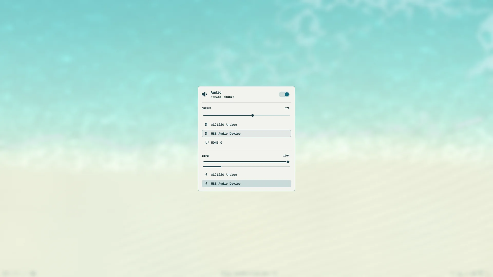
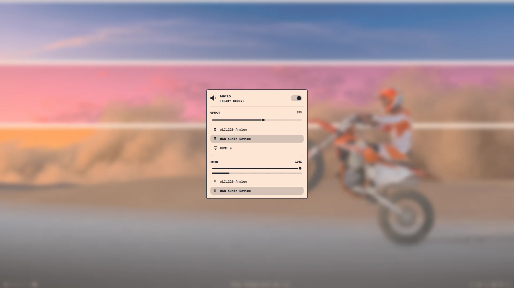

# Centered shell panels

Omarchy's bar panels (Display, Audio, Network, Power…) open centered on screen over a
blurred desktop, instead of beside their widget on the bar. Switching panels with
`Ctrl+←` `Ctrl+→` keeps the backdrop.

|  |  |
|---|---|

## Settings

- **Centered panels** in the wheel (type `wheely settings`) switches between centered
  panels and Omarchy's own placement beside the bar.
- **Backdrop** sets how much the backdrop blurs and dims; 0% turns the blur off.
- For a different blur strength, set `decoration.blur` after wheely's block in your
  Hyprland config; `passes` has the most effect.

## Known limits

- The Display panel takes a moment longer than the others to appear.

How it works, how the patches are maintained, and what was measured:
[`dev/centered-panels.md`](dev/centered-panels.md).
