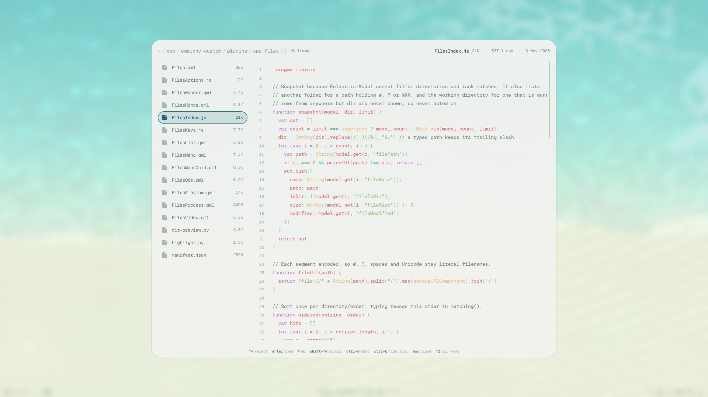
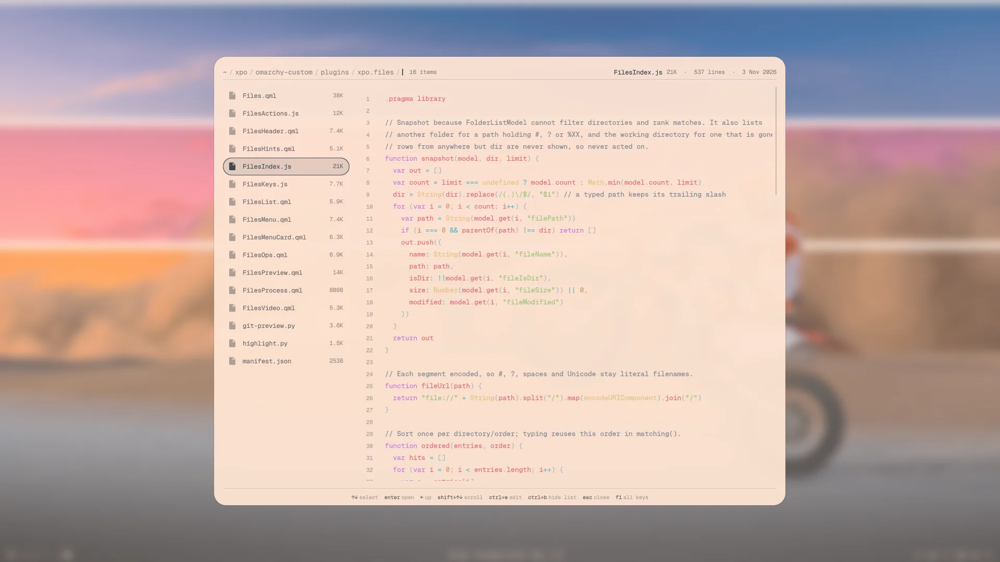
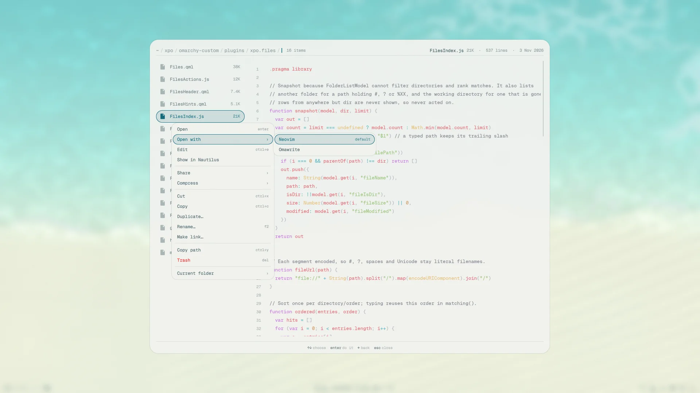
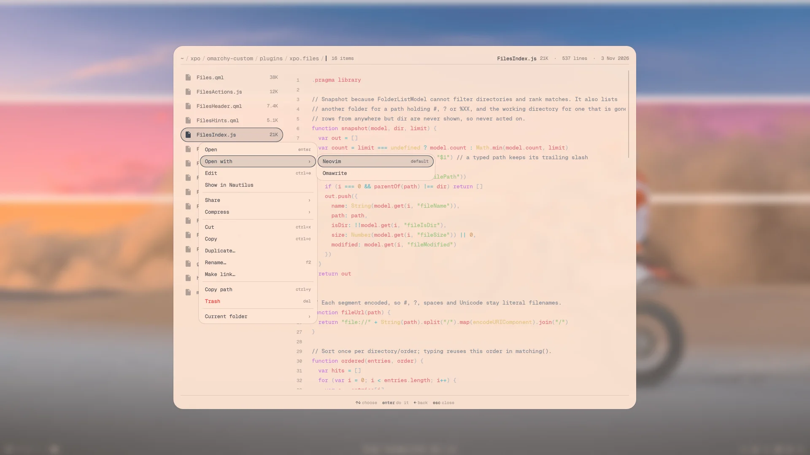

# Files

A keyboard-driven file browser: the folder on the left, a preview of the selection on
the right. Open it by typing `files` in the wheel, or search a file with `/name` and
press `Enter` to land on it.

Every key is in the wheel's manual: type `help files` in the wheel, or see
[`manual.md`](../plugins/xpo.wheel/manual.md). The mouse works too: click to select,
double-click to open, right-click for the menu, `Ctrl`/`Shift`+click to mark.

|  |  |
|---|---|

## Getting around

- It opens at your home folder and stays within it and the folders the wheel searches
  (wheely settings › Searched folders). Those outside home are listed at home by path.
- Type to filter the folder. Start with `/` or `~` to type a path instead, from the
  folder you are in or from home; the list completes it as you go.
- `Enter` opens a folder, or a file in its app; text opens in your editor.
- `Ctrl+O` sorts by name, newest or largest. `Ctrl+H` shows hidden files.

## Previews

| selection | preview |
|---|---|
| folder | its contents, with sizes and dates |
| image | the image, with its pixel size |
| video | plays muted; `Space` pauses (`Shift+Space` types a space), the fullsize button opens mpv |
| Markdown | rendered |
| other text | syntax highlighted, with line numbers |
| anything else | its size |

Files over 256 KiB are not previewed. `Ctrl+B` hides the list so the preview takes the
whole card. Video previews need `qt6-multimedia` and `qt6-multimedia-ffmpeg`.

## Git changes

Inside a git repository the list shows git's letter on changed files (`M`, `A`, `D`,
`?`) and a dot on folders with changes inside. Deleted files stay listed below the
rest. `Ctrl+D` shows a changed file's diff instead of its contents.

## Moving, renaming and making files

- `Ctrl+X` or `Ctrl+C` takes the selection; go to another folder and `Ctrl+V` puts it
  there. A move releases what it held, a copy can be pasted again. A paste skips names
  already taken and reports them; a move that only partly succeeds still releases what it
  held, so select the rest to retry.
- `F2` renames in place. `Ctrl+Shift+N` makes a new file or folder: a name with a dot,
  or ending in `.`, is a file; one ending in `/` is a folder.
- `Del` moves to the trash, so it can be restored. It asks twice.
- Nothing is ever overwritten: a name that is taken is reported, not replaced.
- A paste, extract, compress or trash shows in the header while it runs, with its time,
  how far it has got and a bar along the header's foot. `Ctrl+K` cancels it: a
  cancelled copy, extract or compress leaves nothing half-made, while a move between
  drives may leave its last item half-copied beside the untouched original. One file
  job runs at a time.

## Marking several

`Ctrl+M` marks a row and steps on, `Ctrl+A` marks every row, and `Ctrl`+click or
`Shift`+click marks with the mouse. Cut, copy, copy path, trash and the menu then act on
all marks, including ones the filter hides; the header counts them. `Enter`, `F2` and
`Ctrl+E` still act on the selected row. `Esc` unmarks, and leaving the folder drops the
marks.

## The menu

Right-click an entry, or press `Menu` or `Shift+F10`, for what it can do. Right-click
the path or the empty space below the rows for the folder itself.

|  |  |
|---|---|

| selection | adds |
|---|---|
| any entry | Open with, Show in Nautilus, Share, Compress, Duplicate, Make link |
| image | Convert for sharing, Set as wallpaper, and Copy image under Share |
| video | Convert for sharing, Set as wallpaper |
| archive | Extract here |
| script | Run in a terminal, or Make executable |
| text | Edit |
| folder | Open in a terminal, paste into it |
| deleted file (git) | only Show changes and Copy path |

**Share** sends with LocalSend, to online Taildrop devices, or copies the files for
pasting into another app. **Convert for sharing** makes a smaller copy beside the
original and copies it.

## Editing

`Ctrl+E` edits the previewed text file in place and `Ctrl+S` saves. `Esc` leaves; with
unsaved changes, press it twice to discard. A save never overwrites a change made
elsewhere meanwhile: the new version is shown, your draft is kept, and saving again
overwrites. Files over 256 KiB, binary files, files that are not UTF-8, and files with
CR line endings, no-break spaces or a BOM (which Qt's editor would change) are preview
only. Picking a file in the wheel while an edit is unsaved keeps you on the edit until
you save or discard it.

## Popping out

`Ctrl+T` turns the browser into a normal window that tiles beside your others, and
`Ctrl+T` again brings it back to the overlay. Opened from a pinned search, it opens
inside that search's window.

## Known limits

- Colour arrives a moment after the text.
- Markdown tables render poorly.
- There is no undo, except restoring from the trash.
- A folder whose path holds `#`, `?` or `%` followed by two hex digits cannot be
  browsed (a Qt limitation). Open it in another file manager; search still finds the
  files inside.

How it is built: [`dev/files.md`](dev/files.md).
