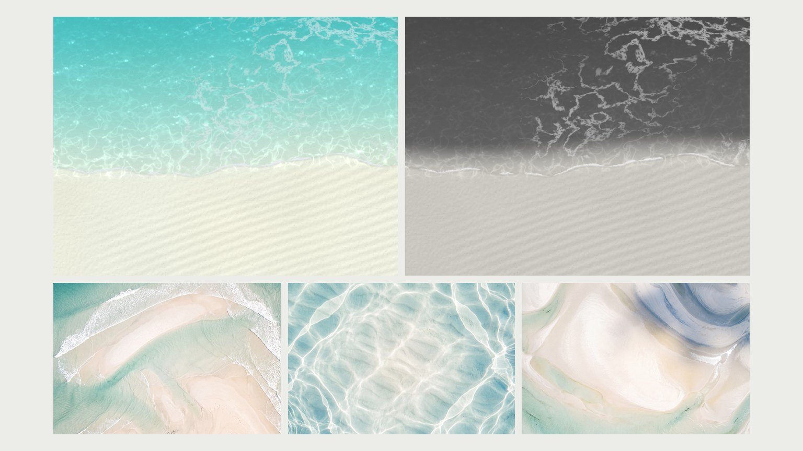

# Tidal

A light Omarchy theme: chalk, sea glass, warm sand, and marine ink.
Two animated coasts and three AI-generated static wallpapers. Independent of Wheely.



## Preview

From the Wheely checkout:

```bash
./themes/tidal/tidal preview
```

The gallery shows both animated coasts, the palette, and the three static images.
Space pauses the tide; Escape closes the gallery. Previewing changes no desktop settings.

## Install

```bash
./themes/tidal/tidal install
omarchy theme set tidal
```

The installer replaces `~/.config/omarchy/themes/tidal` with the theme's colours and
wallpapers, and `~/.local/share/wheely/themes/tidal` with what runs: this command and the
animation. The themes folder is any theme's to replace, so nothing in it is ever run.
It also installs Omarchy theme-change and post-boot hooks for background selection.
Omarchy generates matching app configurations from `colors.toml`; `shell.toml`
supplies the soft grey surfaces and sea-glass selections.
Wheely's installer does not install or select Tidal.

## Animated coasts

Open Omarchy's **Background** picker, including through Wheely. The first two
thumbnails are animated:

| Wallpaper | Palette |
|---|---|
| **Living Coast — Animated** (`00-living-coast-animated.jpg`) | Turquoise water and warm ivory sand |
| **Muted Coast — Animated** (`00-muted-coast-animated.jpg`) | Dark charcoal water and a warm grey shore |

Choose any static image to switch back. You can also select either animation with:

```bash
~/.local/share/wheely/themes/tidal/tidal animate
~/.local/share/wheely/themes/tidal/tidal animate muted
```

The camera holds a settled shoreline, with a gentle ebb and return over 24 seconds.
Both palettes share the same foam, caustics, lighting, and wave motion.
Smaller washes lap along the sand independently over 12 seconds.
Adapted from Wheely's original Shore shader, with colorful and muted palettes and
water light moving at 25% of Shore's speed.

Quickshell renders one input-transparent surface per display, above the shell's
static background and below application windows. It takes no keyboard focus or
screen space. A 32 ms timer targets about 30 animation updates per second.
The detailed foam, caustics, and ripples render directly at the display's resolution,
including 4K, with no low-resolution texture cap or upscaling. No video player
is needed.

Foam uses a seamless bubble texture. Wave geometry and old tide marks are cached at
the display's pixel width and refreshed only when its size or scale changes; motion
and fine detail still render at full resolution on every update.
Repeating noise uses a 64 KiB cache per surface of its original lattice values, preserving the
same interpolation and slopes without recalculating hashes for each pixel.
The shader also skips noise whose weight is exactly zero, which the held tide makes common.

```bash
~/.local/share/wheely/themes/tidal/tidal pause
~/.local/share/wheely/themes/tidal/tidal resume
~/.local/share/wheely/themes/tidal/tidal toggle
~/.local/share/wheely/themes/tidal/tidal stop
```

With Wheely installed, Ctrl+Space pauses and resumes Tidal or Wheelie while one
of them is the active theme. Change the key with Wheely's Wallpaper pause setting (`wheely settings`).

Selecting a static wallpaper unloads the animated surfaces. The small controller
stays idle, watching Omarchy's selection, so choosing either coast starts it again.
Changing theme ends the controller; the hooks start it again after login and when
Tidal is chosen.
The `stop` command selects the last static wallpaper; pause freezes the animation.
Display-off, session-lock, and compositor-confirmed fullscreen coverage pause that
display's coast within one second. Waking it preserves the tide and any manual pause.

## Static collection

| Wallpaper | Composition |
|---|---|
| [Shoreline](backgrounds/01-shoreline.jpg) | A sweeping boundary between turquoise water and ivory sand |
| [Shallows](backgrounds/02-shallows.jpg) | Sunlit caustics over a quiet central sand bank |
| [Ebb](backgrounds/03-ebb.jpg) | Sculpted sand flats and branching tidal channels |

The static JPEGs were generated at Google Gemini 3 Pro Image's native 4K tier (5504 × 3072)
and are shipped resized to 3870 × 2160 at JPEG quality 90, with no other edits. Both
animated coasts render at screen resolution; their picker thumbnails are 3840 × 2160
shader captures at JPEG quality 95 with full-resolution color (4:4:4).
Prompts, model, and generation provenance are in [PROMPTS.md](PROMPTS.md).
Each static JPEG's metadata marks it as AI-generated (IPTC `trainedAlgorithmicMedia`) and names the model.
The code is under the repository's [MIT license](../../LICENSE). No copyright is claimed in the
generated images; to the extent any rights exist, they are offered under the same license.

## Development

Rebuild the shaders after editing `animated/*.frag`:

```bash
scripts/build-shaders.sh themes/tidal/animated/*.frag
python3 tests/tidal.py
python3 tests/tidal-geometry.py
```

The bundled bubble texture is reproducible with `python3 animated/bake-bubbles.py`
from this theme directory (requires NumPy and ImageMagick). What the checks cover is in
[`tests/README.md`](../../tests/README.md).
Tested on Omarchy 4.5.0rc3 and Quickshell 0.3.2.r7.
