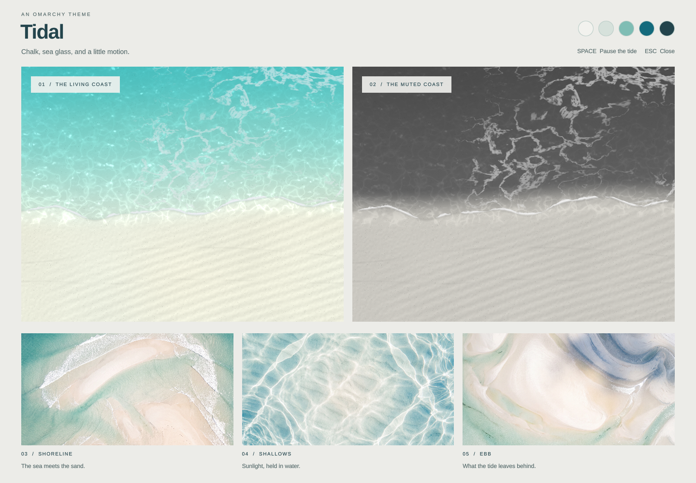

# Tidal

A light Omarchy theme: chalk, sea glass, warm sand, and marine ink.
Two animated coasts and three original static wallpapers. Independent of Wheely.



## Preview

From the Wheely checkout:

```bash
./themes/tidal/tidal preview
```

The gallery shows both animated coasts, the palette, and the three static images.
Space pauses the tide; Escape closes the gallery. Previewing changes no desktop settings.

## Install

```bash
./themes/tidal/tidal install
omarchy theme set tidal
```

The installer copies this directory into `~/.config/omarchy/themes/tidal`.
It also installs Omarchy theme-change and post-boot hooks for background selection.
Omarchy generates matching app configurations from `colors.toml`; `shell.toml`
supplies the soft grey surfaces and sea-glass selections.
Wheely's installer does not install or select Tidal.

## Animated coasts

Open Omarchy's **Background** picker, including through Wheely. The first two
thumbnails are animated:

| Wallpaper | Palette |
|---|---|
| **Living Coast — Animated** (`00-living-coast-animated.png`) | Turquoise water and warm ivory sand |
| **Muted Coast — Animated** (`00-muted-coast-animated.png`) | Dark charcoal water and a warm grey shore |

Choose any static image to switch back. You can also select either animation with:

```bash
~/.config/omarchy/themes/tidal/tidal animate
~/.config/omarchy/themes/tidal/tidal animate muted
```

The camera holds a settled shoreline, with a gentle ebb and return over 24 seconds.
Both palettes share the same foam, caustics, lighting, and wave motion.
Smaller washes lap along the sand independently over 12 seconds.
Adapted from Wheely's original Shore shader, with colorful and muted palettes and
water light moving at 25% of Shore's speed.

Quickshell renders one input-transparent surface per display, above the shell's
static background and below application windows. It takes no keyboard focus or
screen space. A 32 ms timer targets about 30 animation updates per second.
The detailed foam, caustics, and ripples render directly at the display's resolution,
including 4K, with no low-resolution texture cap or upscaling. No video player
is needed.

Foam uses a seamless bubble texture for pores and surface lighting. It is loaded
once, with filtered smaller versions for fine detail at different display sizes.

```bash
~/.config/omarchy/themes/tidal/tidal pause
~/.config/omarchy/themes/tidal/tidal resume
~/.config/omarchy/themes/tidal/tidal stop
```

Selecting a static wallpaper or changing theme unloads the animated surfaces.
The small controller stays idle, watching Omarchy's selection, so choosing either
coast starts it again. The hooks restore this behavior after login and theme changes.
The `stop` command selects the last static wallpaper; pause freezes the animation.

## Static collection

| Wallpaper | Composition |
|---|---|
| [Shoreline](backgrounds/01-shoreline.jpg) | A sweeping boundary between turquoise water and ivory sand |
| [Shallows](backgrounds/02-shallows.jpg) | Sunlit caustics over a quiet central sand bank |
| [Ebb](backgrounds/03-ebb.jpg) | Sculpted sand flats and branching tidal channels |

The JPEGs are unmodified `rb imagen` outputs: 5504 × 3072 pixels, generated at
Google Gemini 3 Pro Image's native 4K tier. Both animated coasts render at screen
resolution; their picker thumbnails are lossless 3840 × 2160 shader captures.
Prompts, model, and generation provenance are in [PROMPTS.md](PROMPTS.md).
Code and assets are distributed under the repository's [MIT license](../../LICENSE).

## Development

Rebuild the shader after editing `animated/tidal.frag`:

```bash
/usr/lib/qt6/bin/qsb --glsl '100 es,120,150' --hlsl 50 --msl 12 \
  -o themes/tidal/animated/tidal.frag.qsb themes/tidal/animated/tidal.frag
python3 tests/tidal.py
```

The bundled bubble texture is reproducible with `python3 animated/bake-bubbles.py`
from this theme directory (requires NumPy and ImageMagick). The fragment shader
is 220 lines; both palettes, foam, and overlapping waves stay in the same pass.

The check validates text contrast, the three wallpapers, Omarchy's generated app
configs, GPU captures of both palettes, motion, pause, horizontal surf, native 4K
rendering, continuous wave edges and the hourly clock wrap, and repeated
colorful/muted/static wallpaper selections and theme changes using the same controller.
Tested on Omarchy 4.0.4 and Quickshell 0.3.1.
