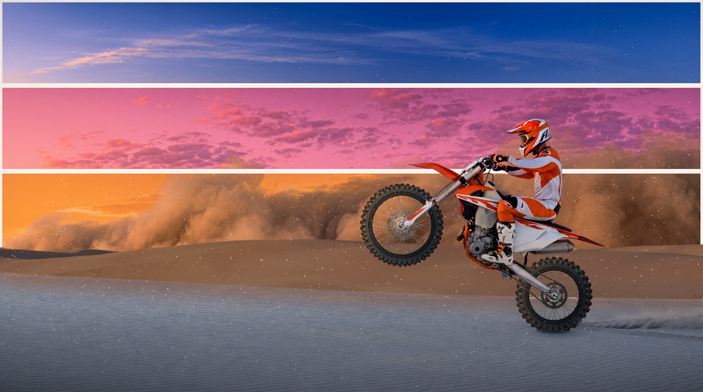

# Wheelie

A light Omarchy theme built around a live desert scene. A rider holds a wheelie
while a sandstorm builds behind three framed sky prints. Native **5504×3072**.



## Theme

The palette in `colors.toml` comes from the scene. The base is `#FEE5D4`, the orange
at the center left of the amber print lifted to a light peach. Text is `#1C222B`, the
foreground sand's blue-grey darkened, at 13:1. The accent is the sand's own `#404651`.
The terminal colors take their hues from the sky prints and dunes, deepened to 6:1;
the bright ones read at 4.6:1. Omarchy generates the app configurations from
`colors.toml`; icons use Yaru's orange set.

```sh
./themes/wheelie/wheelie install
omarchy theme set wheelie
```

The installer prepares the complete theme before stopping the running one, so a failed
copy leaves it untouched; the scene stops only for the directory swap. Rerun the
installer if a later step fails. The baked scene in `scene/` goes in `animated/`.
A native still, `00-wheelie-animated.png`, is the theme's first background; four static
scenes follow it. Theme-change and post-boot hooks start the wallpaper controller,
`scene/wallpaper.qml`. While that still is selected, the controller runs
the live scene on every display. The scene is cropped to fill each screen and sits above
the shell's static background and below windows. It takes no input or focus. Choosing
another background unloads it; choosing another theme also ends the controller, until
the theme-set hook starts it again. Re-applying Wheelie moves Omarchy on to the next
background, as for any theme; select the poster again to resume the scene.
Display-off, session-lock, and compositor-confirmed fullscreen coverage pause that
display's scene within one second. Waking it preserves the wheel angle and any manual
pause. The controller checks monitor state in-process only while animation is selected.

```sh
~/.config/omarchy/themes/wheelie/wheelie pause
~/.config/omarchy/themes/wheelie/wheelie resume
~/.config/omarchy/themes/wheelie/wheelie toggle
```

Wheely binds Ctrl+Space to `toggle` while Wheelie is the active theme. For an app that
needs Ctrl+Space, change the key with Wheely's Wallpaper pause setting
(`wheely settings`). It is separate from Omarchy's Super+Ctrl+Space background
switcher.

## Static backgrounds

The static scenes include forest riding, hard enduro, and two night settings.
Forest trail and hard enduro have a baked black bottom vignette for the bar.
The smooth fade runs from 72% to 98% of the image height, starting up to 6% earlier
at the corners. Both are 5456×3072 quality-100 JPEGs.

| Background | Scene |
|---|---|
| [Forest trail](backgrounds/01-forest-trail.jpg) | A rider on a mossy forest singletrack |
| [Night track](backgrounds/02-night-track.jpg) | A rider airborne over a floodlit motocross jump |
| [Hard enduro](backgrounds/03-hard-enduro.jpg) | A rider climbing an exposed rocky mountain slope |
| [Desert camp](backgrounds/04-desert-camp.jpg) | The bike parked by a campfire under the Milky Way |

## The scene

The rider's front and rear wheels turn under stationary covers, lit from the upper left,
with a drive chain timed to the rear wheel and a contact shadow beneath. Three sky
prints, deep blue, rose-magenta and amber, stand in for the sky as full-width strips
bordered in white. A dense sand bank grows behind the distant dunes over four minutes,
then keeps billowing on a seamless ten-minute loop. Fine sand, nearer flecks and low
wisps drift through it all, faster up close, with grains and puffs lifting beside the
rear tire. The dunes lie in the storm's shade, and a vignette deepens the bottom edge
behind the bar. Pausing holds every particle in place.

### How it is built

- `base.png` holds the scene with the prints baked in; `cutout.png` holds everything but
  the sky and is drawn over the storm, which ends just inside the dunes at the `horizon`
  row in `layout.json`. `Surface.qml` redraws the print borders over the storm from
  `prints` and `printBorder`, so thin dust never ghosts a border through it.
- `HorizonStorm.qml` times the storm; `storm-wall.frag` scales and gently distorts
  `storm.png`, which holds only the dust and is 6336 pixels wide, so it never enlarges
  over the native scene.
- `AmbientDust.qml` sets each dust layer's rate, tint, sizes, lifetimes and velocities;
  `ambient-dust.vert` moves fixed meshes on the GPU, so thousands of particles need no
  geometry uploads each frame. Its clock wraps every 2376 seconds, a common multiple of
  the particle-slot periods, and a generation counter continues the random sequence
  across the wrap.
- The storm shade is baked; `scene-light.frag` darkens the foreground toward the bottom
  edge and its corners in linear light, keeping 25% of the light behind the bar.

## Editing

The scene's images and `layout.json` in `scene/` are baked outside this repository.
After editing a shader in `scene/`, recompile it:

```sh
scripts/build-shaders.sh themes/wheelie/scene/*.{frag,vert}
```

## Asset provenance

- Scene, storm plate, and the night track and desert camp backgrounds:
  `google/gemini-3-pro-image`, 4K.
- Sky prints: `google/gemini-3.1-flash-image`, 4K.
- Wheel sprites, rim finish, and chain material: the built-in imagegen tool.
- `backgrounds/01-forest-trail.jpg` and `03-hard-enduro.jpg`: 5456×3072 outputs
  from `black-forest-labs/flux-3-image`, 4K, 16:9, with the bottom
  vignette added.

Contact shadows and lighting are code-defined.
