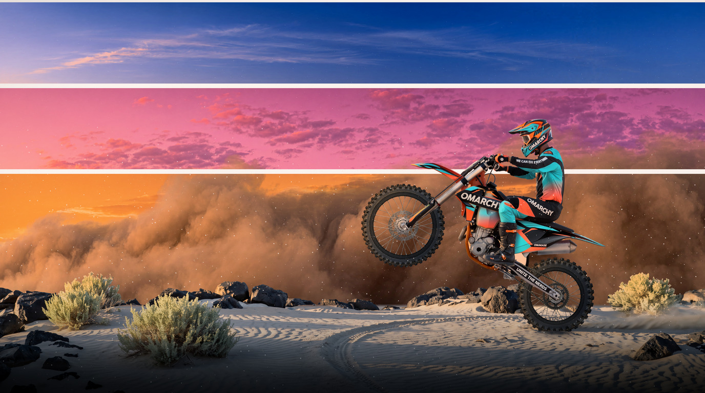

# Wheelie

A dark Omarchy theme built around a live desert scene. A rider in Omarchy colours holds a
wheelie while a sandstorm builds behind three framed sky prints. Native **5504×3072**.



## Theme

The palette in `colors.toml` comes from the rider's livery. The base is `#02383B`, the
livery teal deepened, and text is a peach tinted with the livery orange, `#FFD5C3`, at 9.5:1. The
accent is the livery orange, `#E47D4F`, at 4.5:1, so it reads as text too; the selections are
deep orange. The terminal colours take their hues from the livery, the sky prints, the shrubs, and
the storm, with enough chroma to tell apart, at 5.5:1; the bright ones read at 7.5:1. Omarchy
generates the app configurations from `colors.toml`; icons use Yaru's default orange set.

```sh
./themes/wheelie/wheelie install
omarchy theme set wheelie
```

The installer prepares the complete theme before stopping the running one, so a failed
copy leaves it untouched; the scene stops only for the directory swap. Rerun the
installer if a later step fails. What runs goes apart from the theme, in
`~/.local/share/wheely/themes/wheelie`: this command, and the baked scene in `scene/` as
`animated/`. The themes folder is any theme's to replace, so nothing in it is ever run.
Two native stills come first among the theme's backgrounds, and three static scenes follow:
`00-wheelie-animated.jpg` and `00-wheelie-light-animated.jpg`, the same scene recoloured to daylight.
Theme-change and post-boot hooks start the wallpaper controller, `scene/wallpaper.qml`. While either still is selected, the controller runs
the live scene on every display. The scene is cropped to fill each screen and sits above
the shell's static background and below windows. It takes no input or focus. Choosing
another background unloads it; choosing another theme also ends the controller, until
the theme-set hook starts it again. Re-applying Wheelie moves Omarchy on to the next
background, as for any theme; select a poster again to resume the scene.
Display-off, session-lock, and compositor-confirmed fullscreen coverage pause that
display's scene within one second. Waking it preserves the wheel angle and any manual
pause. The controller checks monitor state in-process only while animation is selected.

```sh
~/.local/share/wheely/themes/wheelie/wheelie pause
~/.local/share/wheely/themes/wheelie/wheelie resume
~/.local/share/wheely/themes/wheelie/wheelie toggle
```

Wheely binds Ctrl+Space to `toggle` while Wheelie is the active theme. For an app that
needs Ctrl+Space, change the key with Wheely's Wallpaper pause setting
(`wheely settings`). It is separate from Omarchy's Super+Ctrl+Space background
switcher.

## fastfetch

The wallpaper's three sky prints, recoloured in Wheelie's livery, sit beside fastfetch: `OMARCHY`
rolls in through a teal dust storm, pops a wheelie and holds it.
`wheely-fetch` plays it: fastfetch's output, then the scene animated over its logo for about four
seconds. Plain `fastfetch`, and Omarchy's About, show its last frame. The installer links
`~/.config/fastfetch/config.jsonc` to the current theme's fastfetch config, unless you already
have one; other themes keep Omarchy's own, since fastfetch skips a link that leads nowhere.

The scene is baked: `themes/fastfetch-bake wheelie` redraws `fastfetch/scene.txt` and
`fastfetch/logo.txt` from `colors.toml`. Its octant characters need a terminal that draws them, as
kitty and Ghostty do; Alacritty and foot take them from the font and show thin seams.

## Static backgrounds

The static scenes show the same rider and livery in wide landscapes. Ridge and night camp have a
baked black bottom vignette for the bar; the highlands' black sand is already dark there. The
smooth fade runs from 72% to 98% of the image height, starting up to 6% earlier at the corners.
Every static background ships resized to 4K (3840 × 2160) at JPEG quality 90.

| Background | Scene |
|---|---|
| [Ridge](backgrounds/01-ridge.jpg) | A rider on a knife-edge mountain ridge above a sea of cloud at golden hour |
| [Highlands](backgrounds/02-highlands.jpg) | A rider crossing a braided glacial river in volcanic highlands |
| [Night camp](backgrounds/03-night-camp.jpg) | The bike by a campfire and tent at an alpine lake under the Milky Way |

## The scene

The rider's front and rear wheels turn under stationary covers, lit from the upper left,
with a drive chain timed to the rear wheel and a contact shadow beneath. Three sky
prints, deep blue, rose-magenta and amber, stand in for the sky as full-width strips
bordered in white. A dense sand bank rises behind the basalt rocks and shrubs over 24
seconds, then keeps billowing on a seamless one-minute loop; it reaches down to the
foreground sand, which takes on some of its dust. Fine sand, nearer flecks and low wisps
drift through it all, faster up close, with grains and puffs lifting beside the rear tire.
A vignette deepens the bottom edge behind the bar. Pausing holds every particle in place.

### How it is built

- `base.jpg` holds the scene with the prints baked in; `cutout.png` holds the rider, bike,
  rocks and shrubs and is drawn over the storm, which ends where the foreground sand begins,
  at the `horizon` row in `layout.json`. `Surface.qml` redraws the print borders over the
  storm from `prints` and `printBorder`, so thin dust never ghosts a border through it; the
  last print's lower edge lies behind the storm and is not drawn.
- `HorizonStorm.qml` times the storm; `storm-wall.frag` scales and gently distorts
  `storm.png`, which holds only the dust and is 6336 pixels wide, so it never enlarges
  over the native scene.
- `Surface.qml` runs one 16 ms clock, about 62.5 animation updates a second. Storm changes
  join every third or fourth tick, 20 times a second, to reduce redundant presentations.
  A Qt animation or `ParticleSystem` would redraw at the display's own rate, so the scene
  uses neither.
- The still scene, storm included, is cached in a native-resolution texture that changes
  20 times a second. Wheels, chain, covers, shadow and dust draw over it and grade themselves
  with `scene-light.glsl`: a layer over moving parts would present every update twice.
- `AmbientDust.qml` sets each dust layer's rate, tint, sizes, lifetimes and velocities,
  and the rear wheel's spray, which is two more layers with gravity, drag and a landing row;
  `ambient-dust.vert` moves fixed meshes on the GPU, so thousands of particles need no
  geometry uploads each frame. Horizontal strips use one collapsed connector column
  between particles, preserving their triangles and particle order with fewer duplicate
  vertices. The dust clock wraps every 2376 seconds, a common multiple of the
  particle-slot periods, and a generation counter continues the random sequence
  across the wrap.
- `scene-light.glsl` darkens the foreground toward the bottom
  edge and its corners in linear light, keeping 25% of the light behind the bar.
- The daylight variant recolours the same images as they are drawn. `daylight.frag` turns the
  sky prints' hues to sky blue, lilac, and soft aqua, lightening them with a gamma so black
  and white hold. `daylightDust` in `scene-light.glsl` turns the storm and the dust in the air
  a sandy haze; the ground, rocks, shrubs and bike keep the plate's own colours. The grade
  then lights it as it lights the original.

## Editing

The scene's images and `layout.json` in `scene/` are baked outside this repository.
After editing a shader in `scene/`, recompile it:

```sh
scripts/build-shaders.sh themes/wheelie/scene/*.{frag,vert}
```

## Asset provenance

- Scene: the earlier `google/gemini-3-pro-image` plate, restyled by the same model with the
  Omarchy livery and a new foreground, then redrawn at full detail by
  `black-forest-labs/flux-3-image`, 4K, and aligned back onto the wheels' positions.
- Storm plate: `google/gemini-3-pro-image`, 4K.
- Sky prints: `google/gemini-3.1-flash-image`, 4K.
- Wheel sprites, rim finish, and chain material: OpenAI's gpt-image.
- Static backgrounds: 5456×3072 outputs from `black-forest-labs/flux-3-image`, 4K, 16:9, from a
  composition draft and the scene's rider as references. Stray lettering was removed in small
  `google/gemini-3-pro-image` patches. FLUX stretched the 3:2 drafts to 16:9, so each was narrowed back
  (by 9–18%) and trimmed top and bottom; then the bottom vignette, then resized like the others.

Contact shadows and lighting are code-defined. All of the images are AI-generated, and each
static background's metadata says so (IPTC `trainedAlgorithmicMedia`) and names the model.
The code is under the repository's [MIT license](../../LICENSE). No copyright is claimed in the
generated images; to the extent any rights exist, they are offered under the same license.
