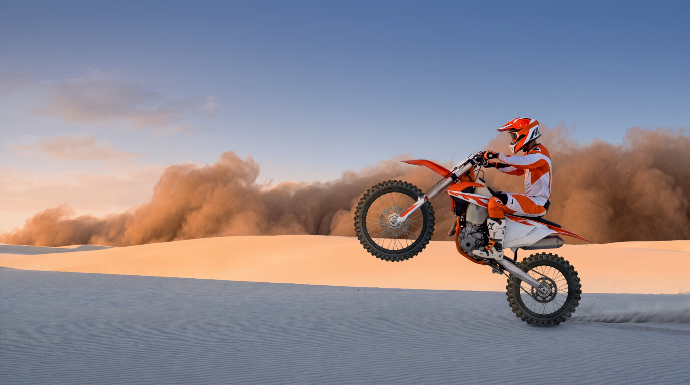

# Wheely desert scene — work in progress

Native **5504×3072** wallpaper scene checkpoint, 2026-10-18.
This is a preview and rebuildable scene, not an installable Omarchy theme yet.



## Next session: stitched sky bands

Replace the sky section with three differently colored skies stitched together:
low bands, each spanning the full width from left to right. Keep the bold pasted
look of the half-baked render, where a sky plate sat in the scene like a pasted
strip, but blend each seam properly. The storm, rider, and dunes stay in front.
The cutout already holds everything that is not sky, so the bands can be drawn
behind it like the storm.

Known issue: for up to about 30 seconds after a hot reload, a few large ambient
wisps show as bright white puffs instead of their faint tint. Fresh launches and
offscreen stills do not show them.

## Ambient dust

The first ambient pass adds fine airborne sand, softer nearby flecks, and faint
low wisps across the scene. Nearby sand moves faster than distant grains, with
varied sizes, lifetimes, and wind speeds. Emitters pre-roll so the air is already
populated when the preview opens. The existing rear-tire grains and puffs remain.

Tune density, tint, size, and motion in `scene/AmbientDust.qml`; all measurements
use the native scene coordinates and share its sunset lighting. This pass is
ready for visual review; theme packaging and installation remain unfinished.
Verified with a native still, QML lint, and frame comparisons: dust moves while
running, holds identical frames while paused, and moves again after resuming.

## Horizon sandstorm

The user judged the storm good on 2026-10-18. A blue-keyed plate always showed
its cut crest, so the storm plate is generated over a dusk sky like the scene's;
its crest fades into sky the way real dust does, and the shader only swaps that
sky for the scene's darker one. Keep the native 6336×2688 source and scene resolution.

A dense, textured sand bank grows behind the distant dunes over four
minutes, then continues billowing there. Its ten-minute texture-flow loop is seamless;
the approach does not reset or jump back. It pauses with the scene's particles.

`scene/HorizonStorm.qml` controls the timing; `scene/storm-wall.frag` scales and
gently distorts `sources/storm-wall-sky-4k.jpg`, keeping its original aspect ratio.
The 6336-pixel-wide source covers the native scene throughout the approach without
enlargement. The bake fits a smooth model of the plate's own sky (`storm-sky.png`);
the shader solves each pixel's dust coverage against it, using the dust hue measured
from the plate, and composites the dust over a deep-blue graduated shade that
darkens the upper sky. Tune the shade on the shader's `dusk` line.

The storm replaces only the sky. `scene/rider-trace.svg` and `scene/dunes.svg` are
rough hand traces; near them `sky.py` separates the plate's sky from the rider,
bike, and dunes, and writes everything else to `cutout.png`, drawn over the storm
with decontaminated anti-aliased edges. The storm ends just inside the redrawn
dunes, at the `horizon` row in `layout.json`. The sky enclosed between the forearms is
seeded explicitly. The front wheel's plate holds borrowed sky, so the dunes'
skyline continues straight behind it. The wheel layers draw above the storm.
The bake gives changed storm shaders a new filename so Qt reloads their code
in the existing preview window. It writes the QML last and deletes superseded storm
shaders, so a reload during the bake cannot run stale shader code.

## Current checkpoint

- Separate front/rear wheels with concentric hubs and rims, matte rim finishes,
  and even tire shading to avoid rotating white patches that look like wobble.
- Animated drive chain, with links timed to the rear wheel and masked behind
  the boot and swingarm. The user marked this done.
- A stronger stationary contact shadow beneath the rear tire, accepted for now.
- Pronounced warm sunset lighting across the scene, with cooler foreground sand.
  Wheel lighting stays fixed to the upper-left light source while the tires turn.
- Existing rear-wheel sand grains and puffs remain a starting point for dust work.
- Ambient airborne sand and low drifting wisps fill the wider scene.
- A distant sandstorm slowly approaches, with moving billows behind the rider.

Keep the native resolution. Use one ordinary preview window. **Never resize,
move, float, or rearrange it.** The scene letterboxes in the preview window.

## Build and preview

From the repository root:

```sh
python themes/wheely/bake.py
qmllint themes/wheely/build/*.qml
quickshell -n -p themes/wheely/build
```

Dependencies: Python, NumPy, ImageMagick, Quickshell, and Qt's shader baker at
`/usr/lib/qt6/bin/qsb`. Tested with Quickshell 0.3.1 and Qt 6.11.2.
Edit `scene/`, then rebuild; `build/` is generated and Git-ignored.

For a matching native still (optional final argument is wheel angle in degrees):

```sh
python themes/wheely/render.py themes/wheely/build themes/wheely/wallpaper-4k.png
```

The renderer uses the same QML and shaders offscreen with OpenGL. It needs access
to the graphics session but opens no desktop window. The still is Git-ignored.
Particles run during capture while the wheels hold the requested angle, so dust
positions vary between stills.
`preview.jpg` is a small documentation image; it is not used by the scene.

## Files and checks

`scene/` owns the QML, lighting and storm shaders, dust textures, traces, and contact shadow.
`sources/` contains every rebuild input; no scratch-directory inputs are required.
`bake.py` builds wheel layers, stationary covers, the chain atlas, and compiled shaders.
`wheels.py` aligns sprites and evens tire illumination; `chain.py` places the links;
`sky.py` builds the sky-free cutout and the storm plate's sky model.
`render.py` captures the assembled scene without duplicating its lighting code.

The cleanup was checked by rebuilding from these inputs, comparing the decoded
runtime assets with the accepted prototype, linting QML, compiling Python and
shaders, and rendering the native still. The live preview was verified earlier
with unchanged window geometry and consistent lighting at multiple wheel angles.

The old experiments and detailed review captures remain local under
`misc/bike/archive/v3-2026-10-17/`. The already-open legacy preview still reads
`misc/bike/v3/out`; leave it in place until that window is closed. Start subsequent
previews from `themes/wheely/build`. The old scratch path is not a source directory.

## Asset provenance

- `sources/scene.jpg`: original 5504×3072 output from
  `google/gemini-3-pro-image` via `rb imagen`, 4K, 16:9. Its decoded pixels exactly
  match the PNG used during development. Prompt: [scene](prompts/scene.txt).
- `sources/base.png` and `sources/layout.json`: preserved compositing plate and
  original wheel geometry derived from that scene. Required by the mask rebuild.
- `sources/wheels.png`: separate front/rear wheel sprites generated using the
  built-in imagegen tool. Prompt: [wheels](prompts/wheels.txt).
- `sources/matte-rims.png`: imagegen edit; only the rim finish is used by the bake.
  Prompt: [matte rims](prompts/matte-rims.txt).
- `sources/chain.png`: imagegen chain material. The bake extracts a single link
  and constructs the measured route. Prompt: [chain](prompts/chain.txt).
- `sources/storm-wall-sky-4k.jpg`: original 6336×2688 dust-bank plate over a
  dusk sky from `google/gemini-3-pro-image` via `rb imagen`, 4K, 21:9, preserved
  unaltered. The shader removes its sky. Prompt: [sandstorm](prompts/storm-wall-sky-4k.txt).

Contact shadows and lighting are code-defined. Generated source assets are kept
unaltered; new bakes reproduce the compositing and motion layers from them.
